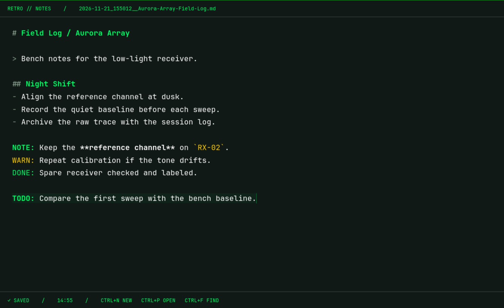
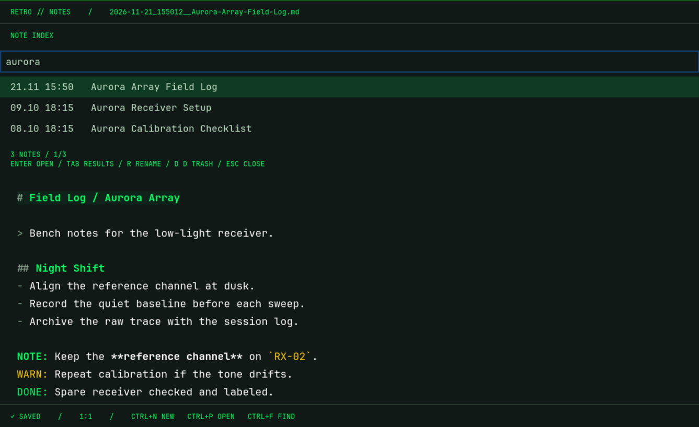
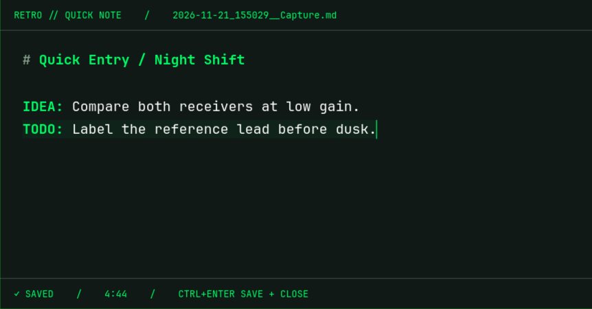

# RetroNotes

[Deutsch](README.md) · English

RetroNotes is a native GTK editor for local Markdown notes on Linux. Open a window, start writing, and switch notes from the keyboard. RetroNotes saves as you type. Your notes stay in plain Markdown files that other editors can open.



## Quickstart

You need Linux, Python 3.11 or later, GTK 4, and PyGObject for the same Python interpreter. On Arch Linux and Omarchy, install the `python-gobject` and `gtk4` system packages. The desktop checks ran on Arch/Omarchy with Wayland. X11 and other distributions are unverified for this release.

Run these commands from the extracted source directory:

```sh
python install.py
export PATH="$HOME/.local/bin:$PATH"
rnote
```

The installer works offline and runs without root. It installs the app under `~/.local/share/retronotes` and the launcher under `~/.local/bin`. You can also run `./rnote` from the source directory. To update, run the installer from the newer source package. Use `python install.py --uninstall` to remove the app. Your notes and trash stay in place. For a custom installation location, pass `--prefix PATH` when installing and uninstalling.

## Write and find notes

| Action | Shortcut or command |
| --- | --- |
| Create a note and start writing | `Ctrl+N`, enter a title, then press `Enter` |
| Browse recent notes or filter by filename | `Ctrl+P`, type a query, then press `Enter` to open the selected note |
| Search the current note | `Ctrl+F`, type a query, then press `Enter` to jump to the next match |
| Open Quick Entry | `rnote --quick`, then `Ctrl+Enter` to save and close |
| Capture a note from the terminal | `rnote 'IDEA: repeat the calibration'` |
| Save now or retry after a write error | `Ctrl+S` |
| Open the built-in guide | `F1` |

The editor highlights Markdown syntax and markers such as `TODO:` and `WARN:` inline. The note index also supports renaming notes and moving them to a local trash folder. For every shortcut and command-line option, see the [FIELD MANUAL](docs/FIELD_MANUAL.md).

| Note index | Quick Entry |
| --- | --- |
|  |  |

## Local storage and privacy

RetroNotes stores UTF-8 Markdown files in `~/Notes` by default. Use `rnote --notes-dir PATH` to choose a different folder. It saves after about 500 ms without typing, before switching notes, and when closing. New notes use mode `0600`, and newly created note and trash directories use `0700`. Existing Markdown files keep their Unix permission bits. Symlinked notes are excluded from the index. Trashed notes go to `.trash` inside the notes directory and can be restored using ordinary file tools.

RetroNotes uses local disk storage and can read the desktop palette. There are no accounts, network sync, or telemetry. Notes are stored as plaintext. If saving fails or the app detects an external change, your draft stays in the window. For a conflict, copy the draft and merge the changes in an external editor.

## Limits and verification

Highlighting applies to Markdown source. The cross-note search matches filenames. Use one editor per file and a notes directory you control. Concurrent writes are not coordinated by locks. Invalid UTF-8 or embedded NUL bytes cause an open error. The optional smooth caret remains experimental.

```sh
PYTHONDONTWRITEBYTECODE=1 python -m unittest discover -s tests -v
```

The two native GTK window tests require a graphical session. For the checksums and package steps, see the [packaging guide in German](docs/PACKAGE.md). [Release notes in German](docs/RELEASE_NOTES.md) · [MIT license](LICENSE) · [Dependencies and provenance in German](docs/THIRD_PARTY.md)
