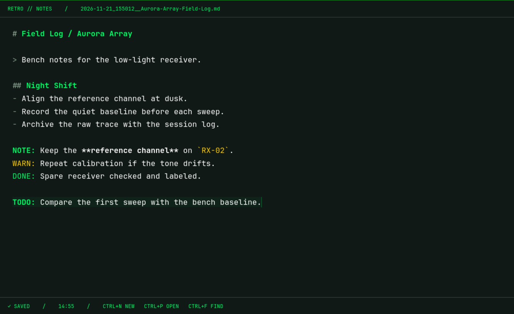
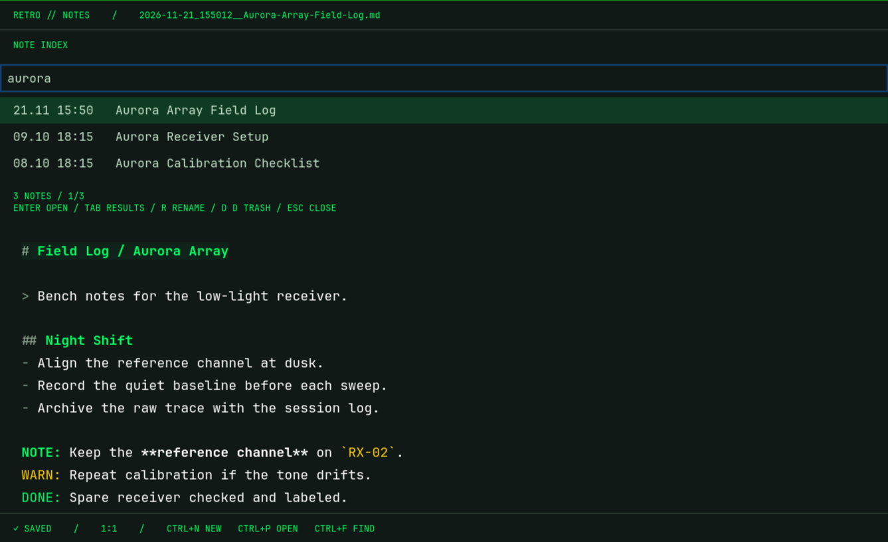
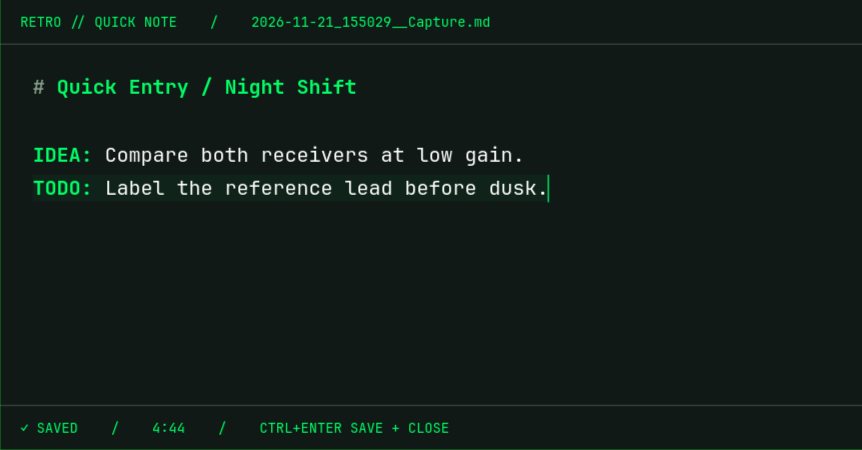

# RetroNotes

Ein nativer GTK-Editor für lokale Markdown-Notizen unter Linux. Fenster öffnen, schreiben und mit der Tastatur zur nächsten Notiz wechseln. RetroNotes speichert automatisch. Deine Notizen bleiben normale Markdown-Dateien, die auch andere Editoren öffnen können.



## Quickstart

Du brauchst Linux, Python ≥ 3.11, GTK 4 und PyGObject für denselben Python-Interpreter. Auf Arch Linux und Omarchy installierst du dafür die Systempakete `python-gobject` und `gtk4`. Die grafische Abnahme lief unter Arch/Omarchy mit Wayland. X11 und andere Distributionen wurden für dieses Paket nicht abgenommen.

Führe im entpackten Quellordner aus:

```sh
python install.py
export PATH="$HOME/.local/bin:$PATH"
rnote
```

Der Installer arbeitet offline und ohne Root-Rechte. Er installiert die App unter `~/.local/share/retronotes` und den Befehl unter `~/.local/bin`. Aus dem Quellordner funktioniert auch `./rnote`. Für ein Update führst du den Installer des neuen Pakets erneut aus. Mit `python install.py --uninstall` entfernst du die App. Notizen und Papierkorb bleiben erhalten. Ein abweichendes Installationsziel gibst du bei Installation und Deinstallation mit `--prefix PFAD` an.

## Schreiben und Wiederfinden

| Aktion | Tastenkürzel oder Befehl |
| --- | --- |
| Notiz anlegen und direkt schreiben | `Ctrl+N`, Titel eingeben, `Enter` |
| Neueste Notizen und unscharfe Dateinamensuche | `Ctrl+P`, Suchtext eingeben, `Enter` öffnet den Treffer |
| In der aktuellen Notiz suchen | `Ctrl+F`, Suchtext eingeben, `Enter` springt zum nächsten Treffer |
| Quick Entry öffnen | `rnote --quick`, mit `Ctrl+Enter` speichern und schließen |
| Aus dem Terminal erfassen | `rnote 'IDEA: Kalibrierung wiederholen'` |
| Sofort speichern oder einen Schreibfehler erneut versuchen | `Ctrl+S` |
| Eingebaute Bedienungsanleitung öffnen | `F1` |

Der Editor hebt Markdown-Syntax und Markierungen wie `TODO:` und `WARN:` direkt im Text hervor. Der Notizindex unterstützt außerdem Umbenennen und das Verschieben in den lokalen Papierkorb. Die vollständigen Tasten und CLI-Optionen stehen im [FIELD MANUAL](docs/FIELD_MANUAL.md).

| Notizindex | Quick Entry |
| --- | --- |
|  |  |

## Lokale Speicherung

Standardmäßig liegen die UTF-8-Dateien unter `~/Notes`. Mit `rnote --notes-dir PFAD` wählst du einen anderen Ordner. Nach rund 500 ms Tipp-Pause sowie beim Wechseln und Schließen speichert RetroNotes. Neue Notizen sind mit Modus `0600` für den eigenen Benutzer angelegt. Neu angelegte Notizordner und Papierkörbe verwenden `0700`. Bestehende Markdown-Dateien behalten ihre klassischen Berechtigungsbits. Verlinkte Notizdateien erscheinen nicht im Index. Gelöschte Notizen landen in `.trash` unter dem Notizordner und lassen sich mit dem Dateimanager zurückverschieben.

RetroNotes nutzt die lokale Festplatte und die Palette des Desktops. Die Anwendung enthält keine Kontoanmeldung, Netzwerksynchronisierung oder Telemetrie. Die Notizen liegen als Klartext vor. Bei Schreibfehlern oder erkannten externen Änderungen bleibt der Entwurf im Fenster. Für Konflikte kopierst du den Entwurf und führst die Änderungen extern zusammen.

## Grenzen und Prüfung

Die Hervorhebung ist eine Schreibhilfe für Markdown-Quelltext. Die Suche über mehrere Notizen arbeitet auf Dateinamen. Verwende einen Editor pro Datei und einen Ordner unter deiner Kontrolle. Gleichzeitige externe Schreibzugriffe werden nicht durch Sperren koordiniert. Ungültiges UTF-8 und eingebettete NUL-Bytes führen zu einem Ladefehler. Der optionale Smooth Caret bleibt experimentell.

```sh
PYTHONDONTWRITEBYTECODE=1 python -m unittest discover -s tests -v
```

Die zwei Tests für native GTK-Fenster benötigen eine grafische Sitzung. [Paketanleitung und Integritätsprüfung](docs/PACKAGE.md) · [Release Notes](docs/RELEASE_NOTES.md) · [MIT-Lizenz](LICENSE) · [Abhängigkeiten und Herkunft](docs/THIRD_PARTY.md)
